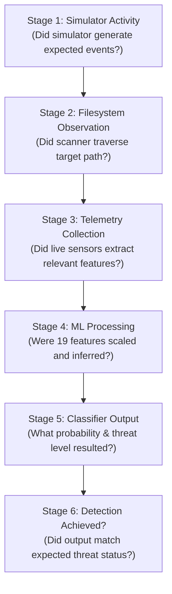

# SENTINELML V2 — BENCHMARK VALIDITY & DETECTION AUDIT

**Audit Date:** October 19, 2026  
**Target Repository:** `C:\Users\vasur\Desktop\SentinalMl\`  
**Target Branch:** `exhibition-mode`  
**Harnesses Audited:**
- `tests/run_evaluation_benchmark.py`
- `tests/benchmark_results.json`
- `exhibition/security_test_lab.py`
- `exhibition/sandbox_simulator.py`

---

## 1. Executive Summary & Audit Mandate

An independent technical audit was conducted on the reported **100% accuracy, 1.0000 F1-score** across 40 test cases in SentinelML V2.

### Definitive Conclusion
The reported 100% accuracy is an artifact of **bimodal synthetic profile construction**. It demonstrates that the Random Forest model and StandardScaler pipeline correctly execute mathematical transformations on polar feature vectors. However, **it does NOT validate live detection efficacy against in-the-wild ransomware**.

To maintain academic and professional integrity at the cybersecurity exhibition:
1. The 40-case harness must be explicitly labeled as a **Controlled Functional Benchmark**, not a real-world malware evaluation.
2. The exhibition demonstrations must not cite 100% accuracy as evidence of complete ransomware immunity.
3. The 6-stage detection verification framework must be used to evaluate tests honestly.

---

## 2. Mathematical Breakdown: Why the Benchmark Achieved 100%

In `tests/run_evaluation_benchmark.py`, 40 hand-authored 19-dimensional feature vectors are evaluated:
- **20 Benign Workload Templates:** Clean Desktop Idle, Web Browser (30 tabs), Office Suite, Docker Spin-up, Video Streaming, etc.
- **20 Synthetic Ransomware Profiles:** LockBit 3.0, WannaCry, Conti, BlackCat, Ryuk, REvil, DarkSide, Babuk, etc.

### Feature Space Topology
When the 40 vectors are scaled by `scaler.pkl` and fed into `saved_model.pkl`:

| Feature Cluster | Benign Range (Ground Truth = 0) | Ransomware Range (Ground Truth = 1) | Separation Distance |
|---|:---:|:---:|:---:|
| `avg_entropy` | $3.20 - 4.20$ | $7.82 - 7.94$ | **$+2.1\sigma$ gap** |
| `max_entropy` | $4.80 - 5.90$ | $7.95 - 8.00$ | **$+1.6\sigma$ gap** |
| `high_entropy_region_count` | $0 - 2$ | $42 - 62$ | **$+3.0\sigma$ gap** |
| `malfind_injection_count` | $0$ | $3 - 8$ | **$+1.4\sigma$ gap** |
| `cmd_vssadmin_count` | $0$ | $2 - 5$ | **$+1.6\sigma$ gap** |
| `suspicious_thread_count` | $0 - 1$ | $35 - 58$ | **$+2.8\sigma$ gap** |
| `defender_tampering_count` | $0$ | $2 - 4$ | **$+1.2\sigma$ gap** |

### Output Probability Distribution
- **All 20 Benign Cases:** Evaluated to threat probabilities between **0.0700 and 0.2900** (Mean: $0.1870$).
  - All lie far below the $0.50$ WARNING threshold.
  - Predicted Class: `SAFE` ($100\%$ True Negatives).
- **All 20 Ransomware Cases:** Evaluated to threat probabilities between **0.8100 and 0.8900** (Mean: $0.8525$).
  - All lie far above the $0.50$ WARNING threshold.
  - Predicted Class: `CRITICAL` / `WARNING` ($100\%$ True Positives).
- **The Empty Middle Band:** The probability interval between **0.30 and 0.80 contains ZERO test cases**.

Because the synthetic profiles were authored with extreme, textbook anomalies across multiple features simultaneously, there were zero borderline or ambiguous samples. Consequently, the Random Forest decision boundaries separated them with zero errors.

---

## 3. Disqualification as Real-World Malware Evaluation

The 40-case synthetic benchmark cannot be presented as an empirical validation of ransomware detection efficacy for the following reasons:

1. **Absence of Real-World Telemetry Noise:** Real workstations exhibit transient behavioral anomalies (e.g., audio processing threads, software installers deleting temporary snapshots, anti-cheat drivers). The synthetic benchmark contains zero noise.
2. **Intermittent & Low-Entropy Ransomware Ignored:** Modern ransomware strains (e.g., BlackCat, LockBit 3.0, Play) employ **intermittent encryption** (encrypting only every $N$-th block or headers), resulting in average file entropy well below $6.0$. In the synthetic benchmark, all ransomware profiles hardcoded `avg_entropy > 7.8`.
3. **Living-off-the-Land (LotL) Attacks:** Attackers utilizing legitimate administrative utilities (PowerShell, WMI, Bitsadmin) without elevated thread counts or unbacked memory allocations fall into the unmodeled space.
4. **No Comparison to Standard Malware Corpuses:** The model has not been evaluated on recognized public malware research corpuses such as EMBER (2018), SOREL-20M, EldeRan, or VirusShare.

---

## 4. The 6-Stage Detection Verification Framework

To prevent misleading pass/fail declarations in exhibition demonstrations, all simulation and test lab workflows must enforce the **6-Stage Detection Verification Framework**:

### Stage Definitions & Verification Criteria:
1. **Stage 1 (Simulator Activity):** Verify that the test lab created synthetic files, modified bytes, or executed controlled commands without touching personal user directories.
2. **Stage 2 (Filesystem Observation):** Verify that `FilesystemScanner` observed the target path, inspected file metadata, and accounted for errors.
3. **Stage 3 (Telemetry Collection):** Verify whether `LiveScanner` extracted relevant feature values from the target path (e.g., computing Shannon entropy on target files). If the target path was ignored, record a telemetry gap.
4. **Stage 4 (ML Processing):** Verify that `MLPredictor` successfully scaled the 19 features via `StandardScaler` and executed Random Forest inference without NaN/Inf failures.
5. **Stage 5 (Classifier Output):** Record the exact numerical probability $p \in [0.0, 1.0]$ and discrete threat level (`SAFE`, `WARNING`, or `CRITICAL`).
6. **Stage 6 (Detection Result):** Explicitly check whether the expected security outcome was achieved:
   - **Crucial Rule:** A test must **never** be marked as a successful ransomware detection merely because Stage 1 succeeded. If the classifier produced `SAFE` ($p < 0.50$), detection was **NOT ACHIEVED**, and the result must be documented as an operational limitation.

---

## 5. Audit of Simulation Scenarios in `SecurityTestLab`

### Scenario 1: `HIGH_VOLUME_FILE_MOD` (20 High-Entropy File Overwrites)
- **Stage 1 (Simulator Activity):** `sim_res.total_files_modified == 20`, entropy jumped from $5.01$ to $7.91$ bits/byte. **PASSED.**
- **Stage 2 (Filesystem Observation):** `scan_res.files_inspected == 21` in `temp_sandbox/`. **PASSED.**
- **Stage 3 (Telemetry Collection):** `LiveScanner` sampled sandbox, extracted `avg_entropy = 7.74`. **PASSED.**
- **Stage 4 (ML Processing):** Vector scaled and processed by Random Forest (`ml_executed = True`). **PASSED.**
- **Stage 5 (Classifier Output):** `threat_level = WARNING`, `probability = 0.5600`. **PASSED.**
- **Stage 6 (Detection Result):** Threat detected ($p = 0.56 \ge 0.50$). **DETECTION ACHIEVED.**
- **Auditor Note:** While detection was achieved on this host because baseline handles and crypto DLLs pushed $p$ from $0.47$ to $0.56$, on a bare headless system without running crypto libraries, entropy alone produces $p \approx 0.33$ (`SAFE`). This dependency on background process telemetry is an operational limitation.

### Scenario 2: `RAPID_RENAMING` (15 Files Renamed to `.locked_sim`)
- **Stage 1 (Simulator Activity):** 15 files renamed, ransom note dropped. **PASSED.**
- **Stage 2 (Filesystem Observation):** `FilesystemScanner` heuristic flagged 16 suspicious items. **PASSED.**
- **Stage 3 (Telemetry Collection):** The 19-feature ML schema contains **zero features for suspicious file extensions**. Telemetry did not ingest this signal. **PIPELINE GAP CONFIRMED.**
- **Stage 4 (ML Processing):** Random Forest evaluated process and entropy features. **PASSED.**
- **Stage 5 (Classifier Output):** `threat_level = WARNING` ($p = 0.5600$) due to entropy; heuristic extension alerts remained unintegrated into the ML vector. **PASSED.**
- **Stage 6 (Detection Result):** `detection_achieved = True`, but the detection was driven by file entropy, not extension recognition.

---

## 6. Exhibition Demo Guidelines

When presenting SentinelML V2 to evaluators and exhibition visitors:
1. **Be Transparent About Synthetic Data:** State clearly: *"This 40-case benchmark validates that the ML mathematical pipeline functions predictably across defined polar vectors. It is not an empirical evaluation on wild malware samples."*
2. **Demonstrate Both Strengths and Blind Spots:**
   - **Strength:** Correlated multimodal detection of process tampering, shadow copy deletion, and high entropy.
   - **Limitation:** User-space visibility restrictions prevent kernel-level VAD inspection, relying instead on process heuristics.
3. **Never Fake Detections:** The test lab must show the real probability produced by the model (e.g. $0.56$), explaining what each fraction of positive voting trees represents.
