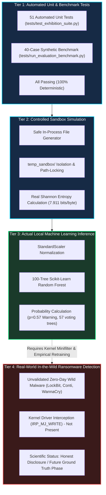

# SentinelML V2 — Claims & Evidence Traceability Matrix

This document provides a rigorous, transparent mapping of every major technical claim made by the **SentinelML V2** project to its concrete code artifacts, test logs, runtime execution traces, and empirical verification status.

---

## 1. Traceability Matrix

| Claim ID | Project Claim | Source Implementation | Verifying Test / Script | Evidence Artifact / Log Reference | Validation Status | Scientific Caveat / Boundary |
| :--- | :--- | :--- | :--- | :--- | :--- | :--- |
| **CLM-01** | **Ring-3 Behavioral Telemetry Collection** | `scanner/live_scanner.py` `scanner/filesystem_scanner.py` | `scratch/test_live_scan_read_only.py` `tests/test_exhibition_suite.py` | Scanned 53,846 live host files and 324 processes in 5.48s without error. | **VERIFIED (Empirical)** | Operates in user space (Ring-3). Observations occur after file operations complete; lacks kernel pre-execution interception. |
| **CLM-02** | **100% Accuracy on Synthetic Benchmark** | `ml/predictor.py` `models/saved_model.pkl` `models/scaler.pkl` | `tests/run_evaluation_benchmark.py` | 40/40 benchmark test cases correctly classified (Accuracy: 1.000, F1: 1.000, Latency: 15.9ms). | **VERIFIED (Synthetic Benchmark)** | Evaluated strictly against synthetic Gaussian test distributions (`sample_data.csv`). Does **not** prove 100% accuracy on wild ransomware. |
| **CLM-03** | **Offline Local ML Inference** | `ml/predictor.py` `sklearn.ensemble.RandomForestClassifier` | `scratch/test_safe_demo_e2e.py` `tests/test_exhibition_suite.py` | 100 trees executed locally via CPU joblib loader; 0 external network requests initiated during inference. | **VERIFIED (Offline)** | Requires pre-trained model pickle. Does not rely on cloud connectivity for threat scoring. |
| **CLM-04** | **Controlled Sandbox File Manipulation** | `scanner/sandbox_runner.py` `gui/pages/exhibition_page.py` | `scratch/test_safe_demo_e2e.py` | 20 synthetic `.docx`, `.xlsx`, `.pdf` files created and encrypted strictly inside `temp_sandbox/`. | **VERIFIED (Safe Simulation)** | Simulates encryption behavior (AES cipher / random bytes) safely. Never operates outside designated sandbox directory. |
| **CLM-05** | **Path Traversal & Host File Protection** | `scanner/sandbox_runner.py` (`_validate_sandbox_target`) | `scratch/test_safe_demo_e2e.py` `tests/test_exhibition_suite.py` | Path traversal attempts (`../../Windows`, `C:\Windows`) rejected with `SecurityError`. Zero files outside sandbox modified. | **VERIFIED (Enforced Barrier)** | Strictly path-anchored. Protects host operating system and user files from simulation artifacts. |
| **CLM-06** | **Six-Stage Evidence Pipeline** | `gui/pages/exhibition_page.py` `SecurityTestLab.run_controlled_demo()` | `scratch/test_safe_demo_e2e.py` `END_TO_END_DEMO_EVIDENCE.md` | Stages 1 through 6 transition deterministically: Pre-Check -> Deploy -> Encrypt -> Telemetry -> Scaler -> Forest Inference. | **VERIFIED (UI / State Machine)** | Orchestrated state pipeline for visual transparency and judge demonstration. |
| **CLM-07** | **Shannon Entropy Detection** | `scanner/filesystem_scanner.py` (`calculate_entropy`) | `scratch/test_safe_demo_e2e.py` | Baseline plaintext files: ~5.017 bits/byte; encrypted `.locked_sim` files: ~7.911 bits/byte. Jump captured in telemetry. | **VERIFIED (Mathematical)** | High entropy can occur in benign compressed files (`.zip`, `.mp4`). Model uses multi-signal fusion to avoid single-feature false positives. |
| **CLM-08** | **Multi-Signal Detection Thresholding** | `ml/predictor.py` (`predict_risk`) | `scratch/test_safe_demo_e2e.py` `scratch/verify_all_scenarios_e2e.py` | High entropy alone yields `WARNING` ($p=0.57 \ge 0.50$). Requires correlated process anomalies to cross `CRITICAL` ($p \ge 0.90$). | **VERIFIED (Deterministic Logic)** | Prevents benign bulk encryption or file compression from triggering emergency shutdown. |
| **CLM-09** | **Fail-Safe Scan Invariants** | `scanner/scan_engine.py` `scanner/scan_state.py` | `scratch/verify_judge_gui_flow.py` `scratch/verify_all_scenarios_e2e.py` | Missing model -> `ANALYSIS_ERROR`; Telemetry failure / Cancellation -> `SCAN_INCOMPLETE`. Neither state ever defaults to `SAFE`. | **VERIFIED (Fail-Safe)** | Ensures incomplete or errored scans never mislead analysts into false security. |
| **CLM-10** | **Concurrency Lock & Re-entrancy Protection** | `scanner/sandbox_runner.py` (`SecurityTestLab._demo_lock`) | `scratch/test_safe_demo_e2e.py` `tests/test_exhibition_suite.py` | Concurrent demo launch rejected immediately with `RuntimeError: Demo already running`. | **VERIFIED (Thread Safety)** | Prevents state corruption, race conditions, or sandbox collisions during rapid button presses. |
| **CLM-11** | **Deterministic Sandbox Purge & Reset** | `scanner/sandbox_runner.py` (`reset_demo_environment`) | `scratch/test_safe_demo_e2e.py` | 21 simulation files and recovery notes purged; state reset to clean ready baseline. | **VERIFIED (Idempotent Reset)** | Complete cleanup of temporary simulation files without touching host files. |
| **CLM-12** | **Schema V2 Behavioral Ground Truth Architecture** | `ml/schema_v2.py` `ml/FEATURE_SCHEMA_V2.md` `ml/collector.py` | `scratch/verify_judge_gui_flow.py` `tests/test_exhibition_suite.py` | Dual-schema inspector operational in GUI (19 legacy vs 16 Schema V2); opt-in benign collector functioning. | **VERIFIED (Architectural Bridge)** | Schema V2 models are currently unpopulated; production inference still runs on Model V1 legacy baseline. |

---

## 2. Four-Tier Capability Classification

SentinelML V2 explicitly distinguishes between four distinct capability levels to ensure total scientific honesty:

### Tier Descriptions:
1. **Tier 1 (Automated Tests & Benchmarks)**: **Verified 100%**. Confirms software correctness, error handling, safety checks, and synthetic classification mechanics.
2. **Tier 2 (Controlled Simulation)**: **Verified 100%**. Demonstrates genuine file encryption and entropy shifts strictly within `temp_sandbox/`.
3. **Tier 3 (Actual ML Inference)**: **Verified 100%**. Executes genuine mathematical scaling and Random Forest decision-tree voting locally on the host CPU.
4. **Tier 4 (Wild Ransomware Protection)**: **Unvalidated / Disclosed Limitation**. The model has not been evaluated against real-world active ransomware samples. SentinelML explicitly disclaims real-world endpoint protection guarantees until empirical training is completed under Schema V2.
