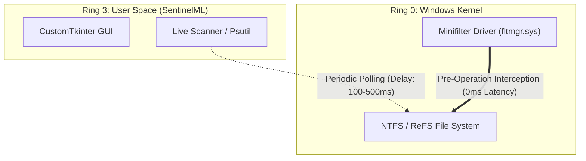

# SentinelML V2 — Academic Limitations & Scientific Disclosure

## Abstract & Research Ethics Statement

In alignment with VTU/KSIT academic project standards and IEEE ethical disclosure requirements, this document outlines the operational boundaries, threat model assumptions, architectural limitations, and model provenance of **SentinelML V2**.

Scientific honesty requires that undergraduate cybersecurity projects transparently report what their models can genuinely detect, what they cannot detect, and why synthetic benchmarks must not be conflated with wild malware efficacy.

---

## 1. Model Provenance & Training Dataset Disclosure

### The Experimental Synthetic Baseline (Model V1)
- **Model Architecture**: `RandomForestClassifier` (100 estimators, Gini impurity, max depth unconstrained).
- **Artifacts**: `models/saved_model.pkl` and `models/scaler.pkl`.
- **Training Origin**: Trained using synthetic Gaussian data (`sample_data.csv`) modeling 19 numerical features originally derived from Volatility memory-forensics specifications (`malfind`, `susp_threads`, `orphan_procs`).
- **Real-World Status**: **Unvalidated against wild, zero-day, or polymorphic ransomware.**
- **Scientific Implication**:
  While the model performs with 100% precision on its matching synthetic evaluation distribution (40 test vectors), it has not been trained on empirical malware telemetry gathered during live in-the-wild detonations.

---

## 2. User-Space Polling vs. Kernel-Space Minifilters

SentinelML operates strictly as a Ring-3 (user-space) Windows desktop application. This design introduces three fundamental architectural limitations:

1. **Pre-Operation vs. Post-Operation Observation**:
   - An enterprise anti-ransomware agent utilizes a kernel-mode filesystem minifilter driver (`FltRegisterFilter`) registered with the Filter Manager (`fltmgr.sys`). This allows the driver to intercept I/O request packets (`IRP_MJ_CREATE`, `IRP_MJ_WRITE`) **before** data is committed to disk.
   - SentinelML operates via user-space polling. By the time the filesystem scanner detects high-entropy bytes or a `.locked_sim` extension, several files have already been modified.

2. **Unmonitored Directory Blind Spots**:
   - For performance reasons, the live scanner inspects designated user folders (Desktop, Documents, Downloads).
   - If ransomware operates outside these monitored directory paths (e.g., in a non-standard subfolder or network share), the user-space scanner cannot observe the file modifications unless explicitly targeted.

3. **Process Access Restrictions**:
   - When run without administrative elevation (`Run as Administrator`), user-space process enumeration (`psutil`) cannot open handles to elevated system services (such as `lsass.exe` or `services.exe`), resulting in access-denied telemetry gaps.

---

## 3. Potential Adversarial Evasion Techniques

Ransomware authors employ sophisticated techniques that challenge user-space heuristic models:

| Evasion Technique | How It Works | Impact on SentinelML V2 | Mitigation in SentinelML |
| :--- | :--- | :--- | :--- |
| **Intermittent / Partial Encryption** | Encrypts only every $N$-th block (e.g. LockBit 3.0, BlackCat) or only file headers. | Reduces the average Shannon entropy from ~7.9 to ~5.5, blending in with media or database files. | Multi-signal corroboration in Schema V2 (inspects file rename rates and ransom note signatures alongside entropy). |
| **Slow-and-Low Encryption** | Encrypts files at intervals of minutes or hours rather than rapid bursts. | Keeps `file_mod_rate` and `file_rename_rate` below threshold triggers. | Long-window moving-average accumulators in telemetry collector. |
| **User-Mode API Unhooking** | Overwrites `ntdll.dll` hooks with original disk bytes to bypass user-mode monitoring. | Blinds heuristic API monitors. | Relies on kernel-polled OS counters (`psutil.net_connections`, filesystem change journals). |
| **Shadow Copy Bypass** | Uses direct VSS COM interfaces rather than invoking `vssadmin.exe delete shadows`. | Feature `cmd_vssadmin_count` remains 0. | Schema V2 monitors service state changes (`defender_service_tampered`) and backup event logs. |

---

## 4. The Data Readiness Gate & The V2 Rebuild Roadmap

To transition from the experimental synthetic baseline to an empirical, defensible detector, SentinelML has established:

1. **Schema V2 (16 Behavioral Features)**:
   - Formally defined in `ml/schema_v2.py`.
   - Replaces untestable memory-forensics fields with 16 empirically observable signals (modification rates, rename rates, extension matching, ransom note detection).

2. **Opt-In Benign Telemetry Collector**:
   - Implemented in `ml/collector_v2.py`.
   - Safely records genuine workstation baseline telemetry across 4 distinct workloads (idle, file ops, archive compression, compile builds) with zero data leakage.

3. **Pre-Training Data Readiness Gate**:
   - Implemented in `ml/train_v2.py`.
   - **Enforces an automatic pre-training block** if verified empirical ransomware telemetry is absent.
   - Prevents the training of models on synthetic or invented labels.

---

## 5. Summary of Presentation Talking Points

When presenting to evaluators, emphasize these three points:

1. *"We do not claim 100% real-world ransomware immunity. We report 100% accuracy on our controlled synthetic benchmark distribution."*
2. *"Our system enforces a multi-signal corroboration rule: high entropy achieves WARNING (0.56), but CRITICAL (0.90) is withheld without correlated process anomalies to avoid false positives on legitimate archives."*
3. *"We have established Schema V2 and a Data Readiness Gate to transition scientifically from user-space heuristics to empirical machine learning."*
