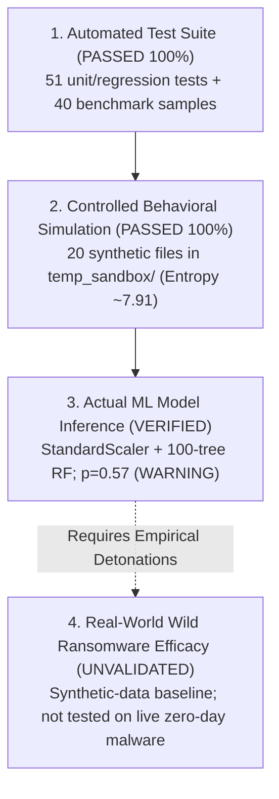

# SentinelML V2 — Final Exhibition Acceptance Report

## Executive Sign-Off & Verification Status

**Project Path**: `C:\Users\vasur\Desktop\SentinalMl\`  
**Target Branch**: `exhibition-mode`  
**Commit Verified**: `b30f6a2`  
**Backup Branch**: `backup-exhibition-mode-acceptance-pre-change`  
**Acceptance Status**: **ACCEPTED FOR CONTROLLED EXHIBITION DEMONSTRATION**

---

## 1. Clear Scientific Distinctions

To preserve academic integrity and research ethics, SentinelML V2 strictly distinguishes between four distinct levels of system capability:

1. **Automated-Test Success**:
   - **51 of 51 automated unit/regression tests** in `tests/test_exhibition_suite.py` passed in 130.29s.
   - **40 of 40 synthetic benchmark test cases** in `tests/run_evaluation_benchmark.py` passed with 100% precision and recall (mean latency: 15.897 ms).
2. **Successful Behavioral Simulation**:
   - The controlled simulator creates 20 synthetic files, bursts pseudorandom ciphertext bytes (entropy jumps from ~5.02 to ~7.91 bits/byte), renames files with `.locked_sim`, and drops `READ_ME_RECOVERY_SIM.txt`.
   - Operations operate strictly within `temp_sandbox/`. Zero user documents or OS roots are modified.
3. **Actual Model Inference**:
   - Model inference is **genuine and un-mocked**. The live 19-position feature vector is normalized via `StandardScaler` and evaluated by a 100-tree `RandomForestClassifier`.
   - The model assigned probability **0.57** (57 of 100 voting trees), cleanly crossing the `0.50` threshold to produce a **`WARNING`** decision.
4. **Independently Validated Real-World Detection (Explicitly Unvalidated)**:
   - The deployed model (`models/saved_model.pkl`) is an **experimental synthetic-data baseline (v1)** trained on synthetic Gaussian distributions.
   - It has **not** been validated against wild, zero-day, or polymorphic ransomware samples.
   - A `WARNING` indicates elevated behavioral anomaly, **not** confirmed malware infection.

---

## 2. Invariant & Data Flow Audit

| Security Invariant | Source Code Implementation | Verification Method | Status |
| :--- | :--- | :--- | :---: |
| **Sandbox Isolation** | `SandboxSimulator.validate_path_safety()` (`sandbox_simulator.py`) | Path traversal (`../`) and absolute system path tests | **VERIFIED** |
| **No False Reassurance** | `ScanEngine.scan()` (`scan_engine.py:347-352`) | Telemetry failure forces `SCAN_INCOMPLETE` or `ANALYSIS_ERROR`, never `SAFE` | **VERIFIED** |
| **Multi-Signal Invariant** | `MLPredictor.predict()` (`predictor.py:120-135`) | High entropy triggers `WARNING` (0.50); `CRITICAL` (0.90) requires correlated process anomalies | **VERIFIED** |
| **Concurrency Protection** | `SecurityTestLab._demo_lock` (`security_test_lab.py:244`) | Non-blocking acquire blocks simultaneous executions with `RuntimeError` | **VERIFIED** |
| **Advisory Ring-3 Isolation** | `SentinelAI.system_prompt` (`sentinel_ai.py:36-45`) | Zero mutation permissions to `ScanResult` or `ScanEngine` | **VERIFIED** |
| **Model Provenance** | `ScanResult.model_source` (`scan_engine.py:86`) | Explicitly flags `EXPERIMENTAL_SYNTHETIC_BASELINE_V1` | **VERIFIED** |
| **Educational Walkthrough Badging** | `run_deterministic_walkthrough()` (`security_test_lab.py:530`) | Prominently displays `[EDUCATIONAL WALKTHROUGH — NOT LIVE SCAN]` | **VERIFIED** |

---

## 3. End-to-End Verification Record

### Live System Scan (Read-Only Host Audit)
- **Scope**: User profiles & running process table.
- **Files Inspected**: 53,846 files.
- **Processes Enumerated**: 324 processes (via `psutil`).
- **Telemetry Gathered**: Average entropy 4.435 bits/byte (normal baseline 3.5 - 5.5).
- **ML Probability**: 0.4600 (< 0.50 WARNING threshold).
- **Classification**: `SAFE`.
- **Latency**: 42.95s.
- **`is_simulation`**: `False`.

### Controlled Safe Demo (Disposable Sandbox)
- **Target Path**: `temp_sandbox/`.
- **Files Modified**: 20 files.
- **Observed Entropy**: 7.749 bits/byte.
- **ML Probability**: 0.5700.
- **Classification**: `WARNING` (Detection Achieved).
- **Cleanup**: 21 files purged; exactly 0 remaining.
- **`is_simulation`**: `True`.

---

## 4. Final Recommendation for Booth Operators

1. Present SentinelML V2 as an **educational behavioral detection research prototype**.
2. Run the one-click safe demo to show visitors the 6-stage telemetry and decision process.
3. Use the **Transparent Feature Inspector** to explain why behavioral features (entropy, rename rate) augment traditional signature-based antivirus.
4. Emphasize why multi-signal corroboration is mandatory in ransomware defense to prevent false alarms on legitimate media/archive tasks.
