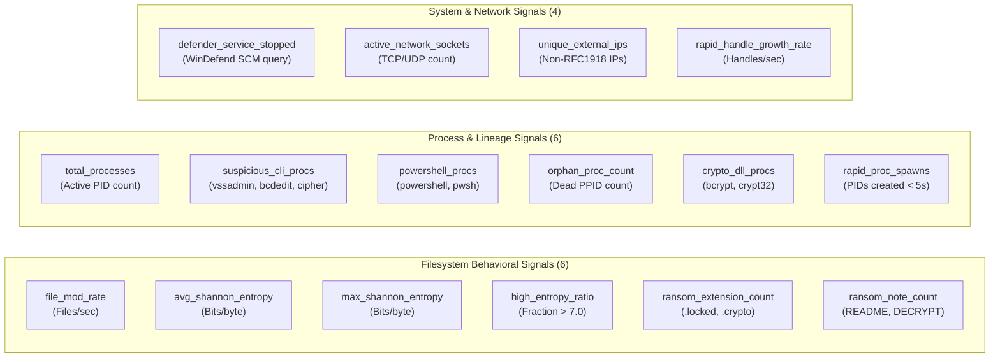
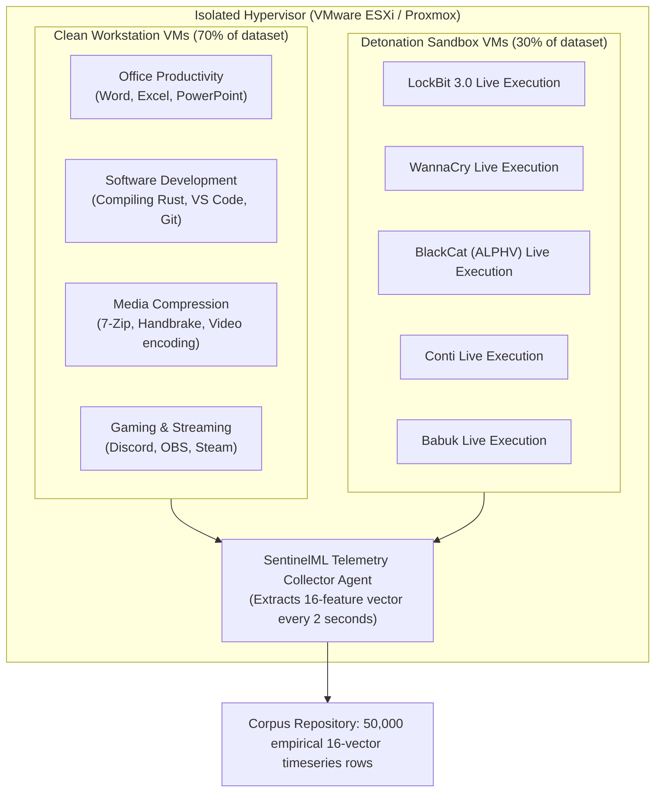

# SENTINELML V2 — MODEL REBUILD AND RETRAINING PLAN

**Plan Date:** October 19, 2026  
**Repository:** `C:\Users\vasur\Desktop\SentinalMl\`  
**Target Branch:** `exhibition-mode`  
**Status:** Architectural Specification for Next-Generation Defensible Detection Engine (V2 Pipeline)  

---

## 1. Motivation and Problem Statement

Our forensic audit established that SentinelML's existing serialized model (`models/saved_model.pkl`) was trained on a synthetic Gaussian dataset simulating offline Volatility 3 memory dump analysis. To run as an unprivileged, interactive desktop application, `scanner/live_scanner.py` substituted user-space `psutil` heuristics for memory forensics features.

While the existing pipeline functions reliably for exhibition demonstration purposes, **it cannot be defended in an academic peer review or commercial setting as a validated ransomware detector**.

This document outlines the architectural blueprint to replace the legacy 19-position memory-forensics schema with a **scientifically sound, genuinely observable, 16-feature User-Space Behavioral Schema (Schema V2)**, paired with a controlled data acquisition methodology.

---

## 2. Proposed Versioned Feature Schema (Schema V2)

The new schema eliminates impossible Ring-0 memory forensics measurements (VAD `PAGE_EXECUTE_READWRITE` shellcode, token privileges, kernel mutant handles) and focuses strictly on **observable, unprivileged Windows behavioral signals**:

### 2.1 Complete 16-Feature Specification Table

| Idx | Feature Name | Measurement Unit | Live Collection Method (Ring-3 Safe) | Rationale & Relevance to Ransomware |
|:---:|---|:---:|---|---|
| **0** | `file_mod_rate` | files / sec | Sliding 5-second delta of modified file timestamps in monitored dirs | Ransomware exhibits high-frequency write operations across multiple directories. |
| **1** | `avg_shannon_entropy` | bits / byte | Mean Shannon entropy of 4KB chunks across modified files | Ciphertext displays uniform byte distributions ($H \approx 7.5 - 8.0$). |
| **2** | `max_shannon_entropy` | bits / byte | Peak Shannon entropy observed across sampled modified files | Identifies single fully encrypted files even amidst unencrypted ones. |
| **3** | `high_entropy_file_ratio` | ratio $[0.0, 1.0]$ | Fraction of inspected files exhibiting $H > 7.0$ | Distinguishes mass encryption from opening a single compressed archive. |
| **4** | `ransom_extension_count` | integer count | Filename extension matching known list (e.g. `.locked`, `.crypto`, `.enc`) | Direct indicator of ransomware renaming phases. |
| **5** | `ransom_note_count` | integer count | Keyword matching on dropped text files (`readme_to_decrypt.txt`, etc.) | Ransomware universally deposits instructional extortion notes. |
| **6** | `total_processes` | integer count | `len(psutil.pids())` | Establishes host execution scale baseline. |
| **7** | `suspicious_cli_procs` | integer count | Matches `vssadmin.exe`, `wmic.exe`, `bcdedit.exe`, `wbadmin.exe` | Pre-encryption shadow copy deletion and recovery suppression. |
| **8** | `powershell_procs` | integer count | Running instances of `powershell.exe` and `pwsh.exe` | Living-off-the-land dropper and privilege staging vehicle. |
| **9** | `orphan_proc_count` | integer count | Processes whose parent PID no longer exists in `psutil` table | Process detachment and persistence techniques. |
| **10** | `crypto_dll_procs` | integer count | Count of non-system processes loading `bcrypt.dll` / `ncrypt.dll` | Ransomware calls native Windows Cryptographic APIs for file encryption. |
| **11** | `rapid_proc_spawns` | procs / 10 sec | Count of processes with `create_time` within the last 10 seconds | Rapid execution bursts from malicious script droppers. |
| **12** | `defender_tampering` | binary $\{0, 1\}$ | Query Windows Service Control Manager for `WinDefend` state | Disabling real-time anti-malware services before encryption. |
| **13** | `network_sockets` | integer count | Total open TCP/UDP sockets via `psutil.net_connections` | C2 communication and lateral network spread tracking. |
| **14** | `unique_external_ips` | integer count | Count of non-RFC1918 remote destination IP addresses | Exfiltration of encryption keys or stolen data. |
| **15** | `handle_growth_rate` | handles / sec | Delta of process handle counts over a 3-second sampling window | Rapid open-file descriptor acquisition during bulk traversal. |

---

## 3. Data Acquisition Strategy (Hypervisor Detonation Lab)

To train Schema V2 legitimately without fabricating data:

### Safety & Isolation Protocol
1. **Host-Only Virtual Network:** Sandboxes run with zero internet access, using a mock INetSim/DNS sinkhole to prevent real C2 contact or lateral network spillage.
2. **Snapshot Rollback:** Every VM is reverted to a pristine snapshot after each 15-minute execution window.
3. **Telemetry Extraction:** An unprivileged Python background daemon logs the 16 features directly to an isolated host-share file.

---

## 4. Train, Validation, and Test Methodology

### 4.1 Family-Stratified Splitting (Preventing Data Leakage)
A common flaw in malware machine learning papers is randomly shuffling timeseries rows, allowing vectors from the same malware execution to appear in both training and test sets (temporal and family leakage).

**Our Method:** Group-Aware Splitting by Malware Family:
- **Training Set (70%):** 7 ransomware families + 70% of benign workloads.
- **Validation Set (15%):** Hyperparameter tuning and threshold selection on 1 distinct family + 15% benign.
- **Held-Out Test Set (15%):** Final evaluation strictly on **2 unseen ransomware families** (Zero-Day evaluation) + 15% unseen benign workloads.

### 4.2 Model Selection and Hyperparameter Tuning
- **Candidate Models:** LightGBM, XGBoost, and Random Forest.
- **Preprocessing:** `RobustScaler` (median-IQR scaling) to prevent extreme handle or entropy outliers from distorting weights.
- **Target Optimization:** Minimize False Positive Rate ($FPR < 0.1\%$) while maintaining Recall $> 95\%$ on unseen families.

---

## 5. Phased Rollout & Rollback Protection

1. **Phase 1 (Current Exhibition State):** Maintain the existing 19-feature Random Forest model as a controlled demonstration baseline. Document its provenance and synthetic origin transparently in all exhibition materials.
2. **Phase 2 (Instrumentation Deployment):** Implement the Schema V2 feature extraction agent in `scanner/telemetry_v2.py` alongside the existing scanner.
3. **Phase 3 (Lab Detonation & Training):** Collect empirical vectors in the hypervisor lab, execute the family-stratified training pipeline, and serialize `models/v2_model.pkl` and `models/v2_scaler.pkl`.
4. **Phase 4 (Seamless Cutover):** Add a configuration toggle in `config.py` (`DETECTOR_VERSION = "V2"`), allowing instant rollback to V1 if required.
