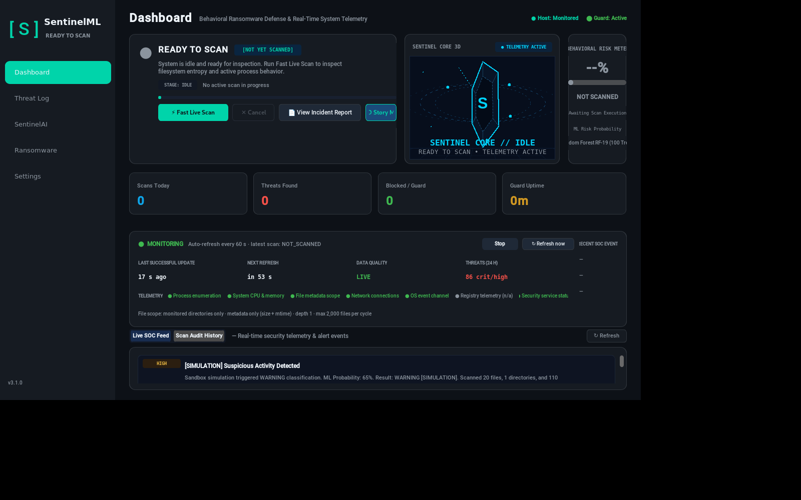
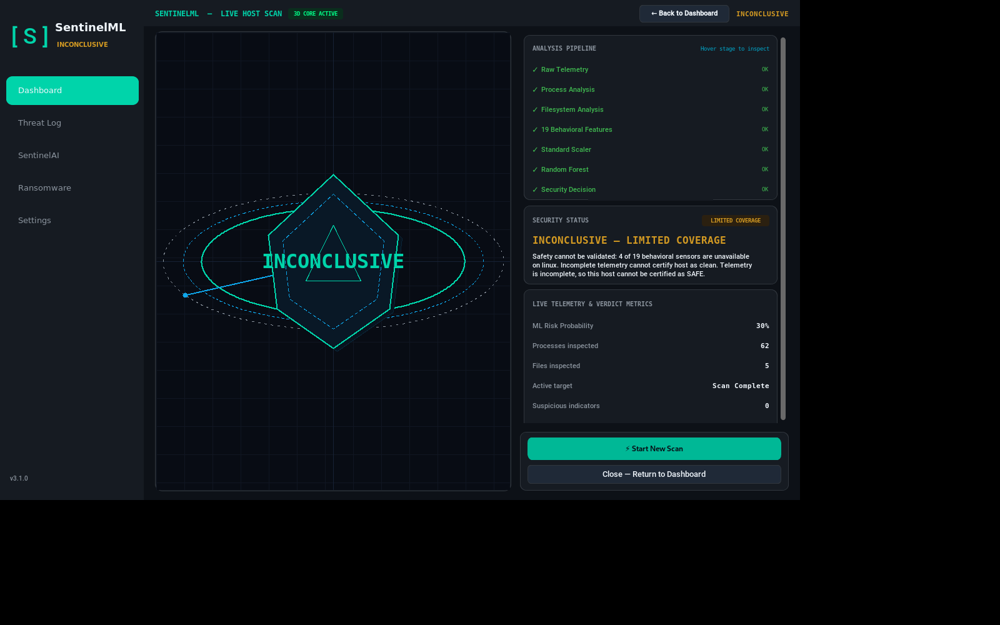

# SentinelML

**Behavioral ransomware defense for Windows and Linux — built on an experimental, synthetic ML baseline.**

[]()
[]()
[]()
[]()

---

> **Detection-accuracy notice**
>
> The bundled model is a Random Forest trained on **synthetic, Windows/Volatility-oriented
> behavioral data**. The stored 95.67% figure is an **in-distribution synthetic test score**,
> not a real-world ransomware detection accuracy. Linux feature vectors are partly
> substituted or zeroed, so Linux predictions are out-of-distribution extrapolations.
> v3.1.0 makes **no validated real-world detection claim**.
> Read [LINUX_DETECTION_ACCURACY_AUDIT.md](LINUX_DETECTION_ACCURACY_AUDIT.md) and the
> [ML baseline disclosure](#experimental-ml-baseline) before evaluating the project.

---

## What's new in v3.1.0 — Kali Linux Compatibility

- **Kali Linux verified.** The app was launched and exercised on Kali GNU/Linux Rolling
  2026.1 (kernel 6.18.12+kali-amd64, Python 3.13.12, Tk 8.6) on a headless Xvfb display:
  startup animation, dashboard, host monitoring, Guard, SOC feed, Live Host Scan page,
  filesystem scan, process-only scan and GUI scan all completed without errors.
- **Process-only scan fixed.** A process scan no longer aborts with
  `No valid scan paths`; it enumerates processes, runs the model only after a valid
  feature vector exists, and completes in about 1.2 s on the audit host
  (65 processes, ML prediction `SAFE`, p = 0.29).
- **`INCONCLUSIVE` handling.** When Linux cannot supply Windows-only sensors, scans report
  `INCONCLUSIVE — LIMITED COVERAGE` instead of `SAFE`. The dashboard, 3D core, alerts and
  scene lab all honour this state; the model output is shown as "model output only".
- **LBS-1 (Linux Behavioral Schema v1) — experimental.** Linux collectors (processes,
  telemetry, entropy, filesystem types, inotify), a schema, a training gate, a guarded
  Linux predictor and evaluation tooling are included. The Linux model path is explicitly
  experimental and is not shipped as a validated detector.
- **Linux packaging and documentation.** PyInstaller spec plus AppImage build script under
  `packaging/linux/`, installation guide, platform matrix, build guide and the full
  Linux accuracy audit.
- **Sanitized release evidence.** Screenshots, scan outputs, error-handling results and
  test logs are published under [docs/releases/v3.1.0/](docs/releases/v3.1.0/README.md).

---

## Verified platform status

| Platform | Status in v3.1.0 | Sensor coverage | Evidence |
|---|---|---|---|
| **Windows 10/11 (64-bit)** | Verified (primary target) | 19/19 | 357 passed, 2 skipped, 0 failed in the release suite |
| **Kali Linux 2026.1 (x86_64)** | Verified from source (headless Xvfb) | 14–15/19 at runtime | 355 passed, 4 skipped, 0 failed; full demo audit |
| **Ubuntu 22.04 / 24.04** | Instructions supplied; not re-validated for this release | ~15/19 | Prior WSL2 work only; no v3.1.0 evidence |
| **macOS 12+** | Code-ready, **unverified** | ~15/19 | No physical Mac testing |

On Linux, `QUICK`/`FULL` scans that miss 4–5 Windows-only sensors end in
`INCONCLUSIVE` by design. `PROCESS` and `CUSTOM` scans can complete normally when every
required input succeeds.

---

## Quick start

### Windows 10/11 (from source)

```powershell
python -m venv .venv
.venv\Scripts\activate
pip install --upgrade pip
pip install -r requirements.txt
python app.py
```

> The Windows executable attached to the existing
> [v3.0.0 release](https://github.com/vasu10-chowdary/SentinelML/releases/tag/v3.0.0)
> predates the v3.1.0 process-only fix. No new binaries are attached to v3.1.0; build from
> source or from a commit you have reviewed.

### Kali / Debian / Ubuntu (from source)

```bash
sudo apt update
sudo apt install -y python3 python3-venv python3-tk python3-dev
python3 -m venv sentinel_venv
source sentinel_venv/bin/activate
pip install --upgrade pip
pip install -r requirements-linux.txt
python3 app.py
```

Verified Kali environment: Python 3.13.12, customtkinter 6.0.0, scikit-learn 1.8.0,
numpy 2.3.5, joblib 1.5.2, psutil 7.1.0, Tk 8.6. `requirements-linux.txt` declares the
supported baseline; record your own versions when reporting results.

For an AppImage build, see [packaging/linux/build_appimage.sh](packaging/linux/build_appimage.sh)
and [CROSS_PLATFORM_BUILD.md](CROSS_PLATFORM_BUILD.md). The v3.1.0 release does not ship a
prebuilt Linux binary.

### Run a scan

1. **Live Host Scan** page → **Start Live Scan** — process-only scan, no filesystem paths.
2. **Dashboard** → **START SCAN** — quick filesystem + process scan.
3. Custom scans accept an explicit directory path.

---

## Scan outcomes

| Outcome | Meaning |
|---|---|
| `SAFE` | Every required input succeeded and model probability < 0.50 |
| `WARNING` | Probability 0.50 – 0.90 |
| `CRITICAL` | Probability ≥ 0.90 |
| `INCONCLUSIVE` / `LIMITED COVERAGE` | One or more required sensors unavailable (typical on Linux). The ML number is labelled "model output only" and the host is **not certified safe** |
| `ANALYSIS_ERROR` | Process extraction or ML evaluation failed. Never presented as `SAFE`; no probability is fabricated |
| `CANCELLED` | User cancellation; no verdict is issued |

The failure contract is regression-tested: process failure, model-load failure, invalid
(NaN/∞) vectors and ML exceptions all end in `ANALYSIS_ERROR`, not `SAFE`.

---

## How it works

```
GUI (CustomTkinter)
  ├─ Dashboard / Live Host Scan / SOC feed / Threat log
  ├─ Scan engine ── process + filesystem collectors ── 19-feature vector
  │                     ├─ Windows path: psutil + Win32 telemetry
  │                     └─ Linux path: LBS-1 collectors (experimental)
  ├─ ML pipeline ── StandardScaler → RandomForest → thresholds 0.50 / 0.90
  ├─ Guard ── filesystem monitoring on user directories
  └─ Audit store / alerts / incident reports
```

Frozen Windows artifacts (model, scaler, metrics, predictor and live scanner) are unchanged
in v3.1.0. See [Frozen artifacts](#frozen-artifacts).

---

## Experimental ML baseline

- **Model:** `RandomForestClassifier`, 100 trees, 19 input features, `StandardScaler`,
  stored `optimal_threshold` = 0.90.
- **Training data:** synthetic, Windows/Volatility-oriented behavioral profiles. Not
  collected from real ransomware executions.
- **Stored metrics** (`models/metrics.json`): accuracy 0.9567, precision 0.9550,
  recall 0.9795, F1 0.9671, ROC-AUC 0.9483, CV F1 0.9608. These are **in-distribution
  synthetic test metrics**.
- **The 40/40 benchmark** in prior documentation is a bimodal synthetic artifact, not a
  detection-accuracy result.
- **Linux:** 4 of 19 inputs are hard-zeroed and several others are semantically
  substituted, so a Linux probability is an extrapolation, not a calibrated risk score.
  The LBS-1 pipeline exists to build a defensible Linux baseline from benign telemetry and
  safe simulations; it has a training gate and is not a validated production detector.
- **No real ransomware** was used in any test or release-evidence run.

---

## Testing and evidence

Release suite: 359 tests across 17 files (13 LBS-1 files plus scan audit, process-only,
INCONCLUSIVE handling and unified dashboard tests).

| Environment | Result | Notes |
|---|---|---|
| Kali 2026.1 (guest VM) | **355 passed, 4 skipped, 0 failed** (306.34 s) | Skips are platform-contract tests for non-Linux hosts |
| Windows 11 (host) | **357 passed, 2 skipped, 0 failed** (188.97 s) | Skips are the two inotify tests |
| Windows 11 (earlier run) | 356 passed, 3 skipped, 0 failed (167.12 s) | One extra skip: a Tk-dependent audit test could not get a display |
| Windows 11 (alternate run) | 355 passed, 3 skipped, **1 failed** | Tk teardown flake `invalid command name "tcl_findLibrary"` in `test_dashboard_3d_core_live_state_transitions`; the test passes in isolation |

Additional verified evidence:

- Five mocked error scenarios (process failure, model-load failure, NaN vector, missing
  sensors, ML exception) — all non-`SAFE`, none fabricated a probability.
- Filesystem CUSTOM scan on a harmless fixture: 3 files, 0 errors, `SAFE`, p = 0.32
  (34.3 s of the 36.9 s total was one-time sklearn warm-up).
- Process-only scan: 65 processes, 0 errors, `SAFE`, p = 0.29, 1.24 s.
- GUI QUICK scan on Kali: 4/19 sensors unavailable → `INCONCLUSIVE — LIMITED COVERAGE`.
- 9 frozen artifact hashes re-verified unchanged.

Full details, screenshots and raw logs: [docs/releases/v3.1.0/README.md](docs/releases/v3.1.0/README.md).

### Frozen artifacts

`models/saved_model.pkl`, `models/scaler.pkl`, `models/metrics.json`, `ml/predictor.py`,
`scanner/live_scanner.py`, `scanner/linux_processes.py`, `scanner/linux_telemetry.py`,
`tests/test_lbs1_processes.py` and `LINUX_LBS1_IMPLEMENTATION_PLAN.md` match their recorded
SHA-256 values (see the evidence index).

---

## Screenshots

Kali VM, headless Xvfb 1600×1000. Full set in
[docs/releases/v3.1.0/screenshots/](docs/releases/v3.1.0/screenshots/).

| Dashboard | INCONCLUSIVE result |
|---|---|
|  |  |

---

## Limitations

1. **No real-world accuracy.** The model is a synthetic baseline; Linux predictions are
   out-of-distribution. Do not present results as validated ransomware detection.
2. **Linux filesystem scans are often `INCONCLUSIVE`** because 4–5 of 19 sensors are
   Windows-specific.
3. **GUI verified on a headless Xvfb display**, not a physical Kali desktop; no compositor
   effects or multi-monitor behaviour were tested.
4. **No native Ubuntu validation** was performed for this release (the planned C0 stage was
   not authorized).
5. **SOC display caveats:** `THREATS (24H)` mixes `[SIMULATION]` alerts, legacy scan alerts
   and clock-skewed records, and `RECENT SOC EVENTS` shows time-of-day without a date.
   Simulation entries are labelled; none is presented as a real detection.
6. **macOS is unverified.**
7. **Single-instance and shared alert store** can produce clock-skew artifacts when the
   same store is used across time zones.

---

## Documentation

| Document | Purpose |
|---|---|
| [INSTALLATION.md](INSTALLATION.md) | Windows / Linux / macOS installation and launch |
| [SUPPORTED_PLATFORMS.md](SUPPORTED_PLATFORMS.md) | Platform tiers and feature availability |
| [CROSS_PLATFORM_BUILD.md](CROSS_PLATFORM_BUILD.md) | Native build and packaging instructions |
| [LINUX_COMPATIBILITY_AUDIT.md](LINUX_COMPATIBILITY_AUDIT.md) | Linux compatibility findings |
| [LINUX_FEATURE_SCHEMA_V1.md](LINUX_FEATURE_SCHEMA_V1.md) | LBS-1 schema and feature definitions |
| [LINUX_DETECTION_ACCURACY_AUDIT.md](LINUX_DETECTION_ACCURACY_AUDIT.md) | Why current metrics are not real-world accuracy |
| [LINUX_LBS1_IMPLEMENTATION_PLAN.md](LINUX_LBS1_IMPLEMENTATION_PLAN.md) | LBS-1 plan (Rev 2, frozen) |
| [LINUX_LBS1_APPROVED_DECISIONS.md](LINUX_LBS1_APPROVED_DECISIONS.md) | Approved design decisions |
| [RELEASE_NOTES.md](RELEASE_NOTES.md) | v3.1.0 and historical release notes |
| [docs/releases/v3.1.0/](docs/releases/v3.1.0/README.md) | Sanitized audit evidence |

---

## Repository layout

```
SentinalMl/
├── app.py                  # entry point
├── constants.py            # app version and shared constants
├── scanner/                # scan engine, Windows/Linux collectors
├── ml/                     # model loader, predictor, LBS-1 pipeline
├── gui/                    # CustomTkinter pages and 3D core
├── guard/                  # filesystem monitoring
├── livemon/                # SOC telemetry
├── exhibition/             # integrity watchtower and scenario lab
├── tests/                  # 359-test release suite
├── tools/lbs1/             # artifact verification and benchmark tools
├── packaging/linux/        # PyInstaller spec and AppImage build script
└── docs/releases/v3.1.0/   # sanitized v3.1.0 evidence
```

Runtime data (`logs/`, `alerts/alerts.json`, generated reports), build outputs
(`dist*/`, `build*/`), virtual environments and `scratch/` are not tracked.

---

## License

MIT License.

---

**SentinelML v3.1.0 — Kali Linux Compatibility** · builds on the unchanged
[v3.0.0 release](https://github.com/vasu10-chowdary/SentinelML/releases/tag/v3.0.0)
