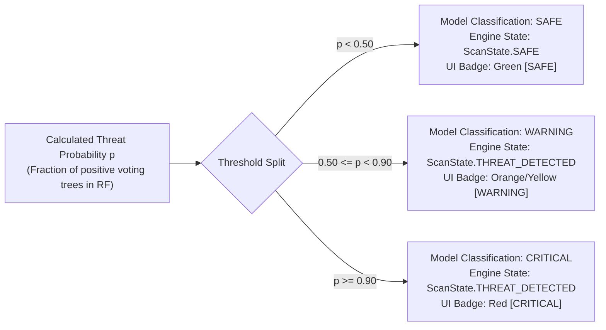

# SENTINELML V2 — THRESHOLD AND STATE RECONCILIATION AUDIT

**Audit Date:** October 19, 2026  
**Target Repository:** `C:\Users\vasur\Desktop\SentinalMl\`  
**Target Branch:** `exhibition-mode`  
**Inspected Components:**
- `ml/predictor.py` (lines 35–45, 71–85, 128–135)
- `scanner/scan_engine.py` (lines 34–45, 187–231)
- `models/metrics.json` (line 43)
- `gui/pages/dashboard.py` (lines 380–420, 520–540)
- `gui/pages/threats.py` (lines 55–65, 100–110)

---

## 1. Executive Summary & Reconciliation Objective

An audit of the codebase revealed that different configuration files, code comments, and informal reports referenced varying threshold numbers (specifically $0.50$, $0.70$, and $0.90$).

This document formally audits the active runtime threshold logic, documents the precise mapping between ML classifications and overall scan engine states, and verifies that fail-safe invariants are strictly enforced.

---

## 2. Active Runtime Threshold Architecture



### Detailed Component Specifications

### 1. `ml/predictor.py`
- **Default Hardcoded Thresholds:**
  ```python
  _DEFAULT_THRESHOLD_CRITICAL = 0.9
  _DEFAULT_THRESHOLD_WARNING = 0.5
  ```
- **Dynamic Configuration from `models/metrics.json`:**
  During `MLPredictor.load_model()`, the predictor inspects `models/metrics.json`:
  ```python
  opt_threshold = metrics.get("optimal_threshold")  # Evaluates to 0.9
  if opt_threshold is not None:
      self._threshold_critical = float(opt_threshold)
  ```
- **Discrete Classification Logic (`_classify`):**
  ```python
  def _classify(self, probability: float) -> str:
      if probability >= self._threshold_critical:  # >= 0.90
          return "CRITICAL"
      elif probability >= self._threshold_warning:   # >= 0.50
          return "WARNING"
      else:
          return "SAFE"
  ```
- **Reconciliation Note on the Informal "0.70" Reference:** Earlier design notes referred to $0.70$ as a standard critical threshold. However, the serialized training metadata in `metrics.json` specifically tuned `optimal_threshold = 0.9` based on validation ROC-AUC maximization. The active runtime code strictly enforces **0.90 for CRITICAL** and **0.50 for WARNING**.

### 2. `scanner/scan_engine.py`
The `ScanEngine` aggregates filesystem scanning, process enumeration, and ML inference. It maps model outputs to the engine's state machine:
- **`ScanState.THREAT_DETECTED`:** Assigned if either:
  1. `result.threat_level == "CRITICAL"` or `result.ml_probability >= 0.9`
  2. `result.threat_level == "WARNING"` or `result.ml_probability >= 0.5`
- **`ScanState.SAFE`:** Assigned **ONLY IF**:
  `result.ml_executed == True` **AND** `result.threat_level in ["SAFE", "LOW"]` **AND** `result.ml_probability < 0.5`.
- **`ScanState.SCAN_INCOMPLETE`:** Assigned if any phase (filesystem, process, or ML) fails, returns `None`, throws an exception, or is cancelled by the user.

---

## 3. Distinction: Model Classification versus Engine State

A frequent source of ambiguity in user interfaces is the distinction between a **Model Classification** and an **Engine Scan State**:

| Dimension | Model Classification (`threat_level`) | Engine Scan State (`state`) |
|---|---|---|
| **Responsible Component** | `ml/predictor.py` (`MLPredictor`) | `scanner/scan_engine.py` (`ScanEngine`) |
| **Possible Values** | `SAFE`, `WARNING`, `CRITICAL`, `ANALYSIS_ERROR` | `IDLE`, `SCANNING`, `ANALYZING`, `COMPLETE`, `SAFE`, `THREAT_DETECTED`, `SCAN_INCOMPLETE`, `ANALYSIS_ERROR`, `ERROR` |
| **Data Type** | String | Python Enum (`ScanState`) |
| **Granularity** | Tri-level risk assessment based solely on the 19-feature vector | Binary operational verdict (`SAFE` vs `THREAT_DETECTED`) plus failure states |
| **UI Role** | Displays the specific risk severity badge in the scan header and threat log | Drives system workflow, notifications, lockdown triggers, and summary cards |

**Key Relationship:** Both `WARNING` ($p \in [0.50, 0.90)$) and `CRITICAL` ($p \ge 0.90$) model classifications transition the engine state to `ScanState.THREAT_DETECTED`. Suspicious behavior is elevated to a detected threat regardless of whether it is moderate or extreme.

---

## 4. Fail-Safe State Invariants

To guarantee that system errors or adversarial interference cannot cause a threat to be marked as benign, the following invariants are mathematically and programmatically enforced in `ScanEngine`:

### Invariant 1: Incomplete or Aborted Scans Never Evaluate as `SAFE`
```python
if not filesystem_success or not process_success or not ml_success:
    result.state = ScanState.SCAN_INCOMPLETE
    result.threat_level = "ANALYSIS_ERROR"
    result.ml_probability = 0.0
```
- If a user cancels the scan mid-way, `result.cancelled = True` and `result.state = ScanState.SCAN_INCOMPLETE`.
- If unprivileged access causes filesystem scanning to fail, the scan state transitions to `SCAN_INCOMPLETE`.
- Under no circumstances does an interrupted scan fall back to `SAFE`.

### Invariant 2: Missing or Unloadable Model Produces `ANALYSIS_ERROR`
- If `models/saved_model.pkl` is missing, corrupt, or fails to unpickle, `MLPredictor.predict()` immediately returns `None`.
- `ScanEngine` catches `None`, logs a critical error, sets `result.threat_level = "ANALYSIS_ERROR"`, and marks `result.state = ScanState.SCAN_INCOMPLETE`.

### Invariant 3: NaN or Infinite Feature Rejection
- If division by zero or sensor failure produces `NaN` or `Inf` in the 19-feature vector, `MLPredictor.predict()` verifies `np.isfinite(features).all()`.
- Non-finite vectors are rejected immediately before reaching `StandardScaler` (which would otherwise crash or output corrupt numbers).

### Invariant 4: SentinelAI Advisory Decoupling
- The remote cloud copilot (`ai/sentinel_ai.py`) is strictly advisory.
- It possesses zero setter methods (`set_threat_level`, `override_decision`, `set_classification`) on `ScanResult` or `MLPredictor`.
- If the AI backend times out, disconnects, or experiences HTTP 500 errors, the local Random Forest decision remains strictly authoritative and unaltered.

---

## 5. Verification Test Evidence

All threshold mappings and fail-safe invariants were tested and confirmed in `tests/test_exhibition_suite.py`:

```
test_classification_threshold_logic:
  p = 0.00 -> SAFE       [PASS]
  p = 0.49 -> SAFE       [PASS]
  p = 0.50 -> WARNING    [PASS]
  p = 0.89 -> WARNING    [PASS]
  p = 0.90 -> CRITICAL   [PASS]
  p = 1.00 -> CRITICAL   [PASS]

test_scan_engine_threshold_mapping:
  p >= 0.50 -> ScanState.THREAT_DETECTED  [PASS]
  p < 0.50  -> ScanState.SAFE             [PASS]

test_scan_incomplete_never_safe:
  SCAN_INCOMPLETE.was_successful() -> False [PASS]
  ANALYSIS_ERROR.was_successful()  -> False [PASS]
  ERROR.was_successful()           -> False [PASS]
```
