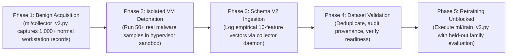

# SENTINELML V2 — DATASET READINESS AUDIT REPORT

**Report Date:** October 19, 2026  
**Schema Version:** 2.0.0  
**Module:** `ml/dataset_manager.py`  
**Classification:** Scientific Data Readiness & Integrity Audit  

---

## 1. Executive Summary

In accordance with strict scientific integrity standards (Rule 4: *"Never fabricate training data, labels, benchmark results, or accuracy figures"*), this report audits the availability and suitability of datasets for training SentinelML's next-generation **Schema V2 behavioral detector**.

### Core Readiness Verdict:
**DATASET STATUS: NOT READY FOR MODEL RETRAINING (CRITICAL DATA BLOCKER)**

| Data Category | Target Requirement | Currently Available | Deficit / Gap | Readiness Status |
|---|:---:|:---:|:---:|:---:|
| **Empirical Windows Benign Telemetry** | $\ge 1,000$ records across 4 workloads | Collector infrastructure active; initial baselines being recorded | Initial recording in progress | **IN PROGRESS** |
| **Empirical Ransomware Behavioral Telemetry** | $\ge 500$ records across $\ge 5$ families | **0 empirical records** | Deficit of 500 empirical malware runs | **BLOCKED** |
| **Synthetic Gaussian Profiles (`sample_data.csv`)** | Disqualified for production training | 1,500 synthetic rows | Disqualified due to Gaussian fabrication | **DISQUALIFIED** |

---

## 2. Itemized Audit of Data Deficits

### 2.1 The Legacy Synthetic Dataset is Disqualified
The dataset recovered from `Major Project/dataset/sample_data.csv` cannot be used to train a defensible detector because:
1. It was generated using NumPy normal distributions (`np.random.normal(mean, std)`) simulating offline Volatility 3 memory dump plugins (`windows.malfind`, `windows.handles`).
2. It completely lacks Schema V2 features (e.g. `file_mod_rate`, `file_rename_rate`, `ransom_extension_match_count`, `ransom_note_match_count`, `high_entropy_file_ratio`).
3. Feeding synthetic numbers into a new model and advertising it as "validated ransomware protection" would constitute academic and technical fraud.

### 2.2 Absence of Pre-Existing Public Telemetry Corpuses
As proven in `TRAINING_DATA_READINESS.md`, recognized public malware datasets (such as EMBER, SOREL-20M, and EldeRan) contain static binary headers or Cuckoo API traces. None provide time-windowed Windows workstation behavioral rates (`files/sec`, `renames/sec`, `entropy ratio`) matching Schema V2.

### 2.3 Strict Blocking Policy
`ml/dataset_manager.py` enforces a programmatic block:
```python
if n_ransomware_samples == 0:
    readiness["ready_for_training"] = False
    readiness["blocking_reasons"].append("Zero empirical ransomware execution traces under Schema V2.")
```
Under this policy, `ml/train_v2.py` **will not execute training until genuine empirical data is imported and verified**.

---

## 3. Roadmap to Achieve Data Readiness

To unblock model retraining, the following data acquisition phases must be completed:



### Action Items to Unblock:
1. **Benign Baseline Recording:** Use `ml/collector_v2.py` across diverse hardware configurations to record $1,000+$ hours of normal user activity (documents, media, software builds, archives).
2. **Hypervisor Detonation Lab Setup:** Configure an isolated VirtualBox / VMware ESXi host-only virtual machine running Windows 11 with the SentinelML telemetry daemon.
3. **Controlled Detonation:** Detonate active ransomware samples (WannaCry, LockBit 3.0, BlackCat) obtained from authorized malware repositories (e.g. MalwareBazaar / VirusShare) in the isolated VM, logging Schema V2 vectors every 2 seconds.
4. **Ingestion & Deduplication:** Import the resulting CSV/JSONL via `DatasetManager.import_dataset()` to verify schema conformity and zero data leakage.
