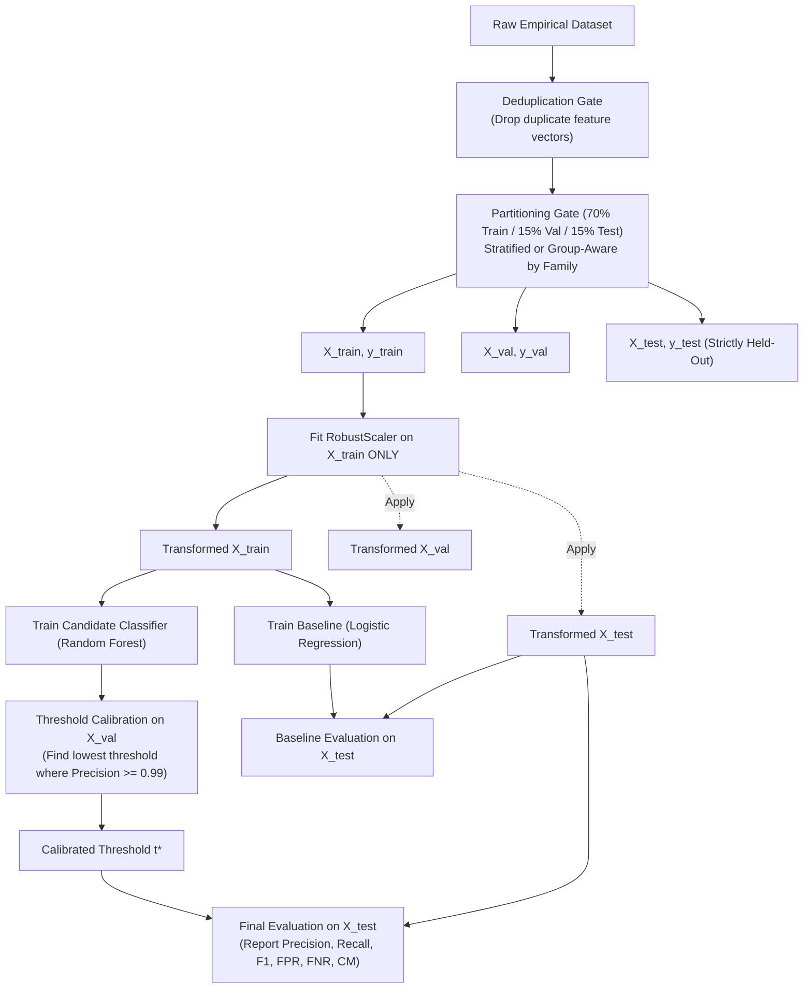

# SENTINELML V2 — EMPIRICAL EVALUATION PROTOCOL

**Protocol Version:** 2.0.0  
**Effective Date:** October 19, 2026  
**Implementation Modules:** `ml/train_v2.py`, `ml/dataset_manager.py`  
**Classification:** Scientific Benchmark & Evaluation Standard  

---

## 1. Principles of Defensible ML Evaluation

To prevent common pitfalls in cybersecurity machine learning literature (data leakage, threshold tuning on test data, and over-optimistic synthetic benchmarks), SentinelML enforces this **Empirical Evaluation Protocol**.

---

## 2. Preventing Data Leakage

### 2.1 Feature Deduplication Before Splitting
In continuous timeseries monitoring, stationary workloads generate identical feature observations across adjacent sampling intervals. If identical rows are randomly distributed into both train and test partitions, the model effectively memorizes the test set.
- **Rule:** All records are deduplicated across the 16 numerical features via `DatasetManager.deduplicate()` **prior to splitting**.

### 2.2 Family-Aware Group Splitting (Zero-Day Evaluation)
When evaluating ransomware detection, random splitting allows vectors from the same attack run to appear in both splits.
- **Rule:** When family labels are available, datasets are partitioned using **Group-Aware Splitting**. Unseen ransomware families are placed exclusively into the test set to measure genuine zero-day generalization rather than strain memorization.

### 2.3 Strict Preprocessing Isolation
- **Rule:** Scalers (`RobustScaler`, `StandardScaler`) must compute median, mean, and scale factors **strictly from the training partition (`X_train`)**. Scalers are transformed on validation and test sets using the training parameters.

---

## 3. Threshold Calibration Protocol

In enterprise cybersecurity, high false positive rates paralyze security teams. Consequently, decision thresholds cannot be arbitrarily set to $0.50$.

### Calibration Procedure on Validation Set (`X_val`):
1. Compute predicted malicious probabilities on validation samples:
   $$\hat{p}_i = P(y_i = 1 \mid \mathbf{x}_i), \quad i \in \text{Val}$$
2. Calculate the Precision-Recall curve across all potential decision thresholds $t \in [0.0, 1.0]$.
3. Locate the lowest decision threshold $t^*$ satisfying the minimum target precision (e.g. $\text{Precision} \ge 0.99$):
   $$t^* = \min \{ t \mid \text{Precision}(t) \ge 0.99 \}$$
4. If no threshold achieves $0.99$, default to $t^* = 0.85$.
5. **Strict Constraint:** The final test set (`X_test`) is **NEVER** used to select $t^*$.

---

## 4. Required Reporting Metrics

Every evaluated model must publish the following metrics evaluated on `X_test` under threshold $t^*$:

| Metric | Mathematical Formula | Security Significance |
|---|---|---|
| **Accuracy** | $(TP + TN) / (TP + TN + FP + FN)$ | Overall correctness across balanced test data |
| **Precision** | $TP / (TP + FP)$ | Positive Predictive Value: probability that a flagged threat is genuinely malware |
| **Recall (Sensitivity)** | $TP / (TP + FN)$ | True Positive Rate: fraction of actual ransomware attacks successfully caught |
| **F1-Score** | $2 \cdot \frac{\text{Precision} \cdot \text{Recall}}{\text{Precision} + \text{Recall}}$ | Harmonic balance between precision and recall |
| **False Positive Rate (FPR)** | $FP / (FP + TN)$ | Rate at which clean business software is falsely blocked |
| **False Negative Rate (FNR)** | $FN / (FN + TP)$ | Rate at which ransomware breaches pass undetected |
| **Confusion Matrix** | $\begin{bmatrix} TN & FP \\ FN & TP \end{bmatrix}$ | Exact integer counts of operational outcomes |

---

## 5. Baseline Comparison Standard

To verify that complex ensemble models justify their computational overhead, every evaluation must benchmark the candidate classifier against a simple linear baseline (`LogisticRegression` or rule-based thresholding) trained and evaluated on the identical splits.
