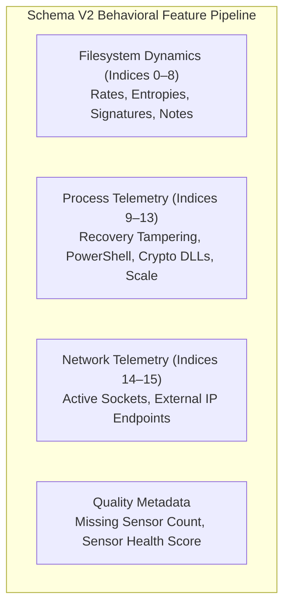

# SENTINELML V2 — BEHAVIORAL FEATURE SCHEMA V2 SPECIFICATION

**Document Version:** 2.0.0  
**Effective Date:** October 19, 2026  
**Module:** `ml/schema_v2.py`  
**Classification:** Scientific Feature Specification & Engineering Reference  

---

## 1. Architectural Motivation

A rigorous technical audit established that SentinelML's legacy 19-feature vector was originally designed for **offline memory forensics using Volatility 3** on physical memory dumps. When ported to an interactive desktop GUI application, the system substituted user-space `psutil` approximations for kernel-level features (`malfind`, token privileges, kernel mutexes, unbacked thread start addresses), creating an unbridgeable distribution shift.

**Feature Schema V2** eliminates all unverifiable Ring-0 and offline memory-dump constructs. It establishes a **16-feature behavioral schema based strictly on telemetry that can be genuinely, reliably, and unprivilegedly extracted from Windows workstations**.

---

## 2. Core Scientific Caveats and Principles

1. **Candidate Signals, Not Conclusive Proofs:**  
   No single behavioral measurement in Schema V2 proves the presence of ransomware. Elevated Shannon entropy ($H > 7.0$) is naturally generated by legitimate software such as 7-Zip, Handbrake, or database engines. Rapid file renaming occurs legitimately during photo sorting or build processes. Detection requires **multivariate correlation across filesystem and process indicators**.
2. **Explicit Overhead & Cost Accounting:**  
   Every feature incurs an operating system cost (CPU cycles, disk I/O, or thread context switching). Schema V2 documents these costs to ensure continuous monitoring does not degrade user workstation performance.
3. **No Fabricated Ring-0 Visibility:**  
   Schema V2 makes zero claims of detecting process injection or memory hollowing in user-space.

---

## 3. The 16-Position Feature Specification Table

| Idx | Feature Name | Data Type | Unit | Collection Method (User-Space Safe) | Computational Cost | False Positive Risks & Benign Triggers |
|:---:|---|:---:|:---:|---|:---:|---|
| **0** | `file_mod_rate` | `float64` | files / sec | Windowed delta of modified file timestamps in monitored path | Low | Compilers, Git checkouts, npm installs, video exports |
| **1** | `file_rename_rate` | `float64` | renames / sec | Directory change notification delta over sliding 5-second buffer | Low | Bulk photo organization, refactoring tools |
| **2** | `files_modified_count` | `float64` | count | Total unique file paths modified during observation window | Low | Application updates, package restores |
| **3** | `files_renamed_count` | `float64` | count | Total unique file paths renamed during observation window | Low | Mass file sorting |
| **4** | `avg_shannon_entropy` | `float64` | bits / byte | Shannon formula on 4KB file chunks: $H = -\sum p_i \log_2(p_i)$ | Moderate | Compressed archives (.zip, .7z), media files, encrypted databases |
| **5** | `max_shannon_entropy` | `float64` | bits / byte | Maximum Shannon entropy observed across sampled file population | Moderate | A single opened `.zip` or `.docx` file |
| **6** | `high_entropy_file_ratio` | `float64` | ratio $[0, 1]$ | Count(files with $H > 7.0$) / Total files inspected | Moderate | Folders containing purely encrypted backups or compressed videos |
| **7** | `ransom_extension_match_count` | `float64` | count | Case-insensitive extension matching against known signature set | Very Low | Security test folders, user-named .locked files |
| **8** | `ransom_note_match_count` | `float64` | count | Filename matching on instructional extortion notes (e.g. `readme_to_decrypt.txt`) | Very Low | Benign documentation files named `readme.txt` |
| **9** | `suspicious_process_count` | `float64` | count | Active process names matching `vssadmin.exe`, `bcdedit.exe`, `cipher.exe` | Low | IT administrator maintenance scripts, legitimate backup software |
| **10** | `powershell_process_count` | `float64` | count | Active instances of `powershell.exe` and `pwsh.exe` | Low | Developer terminals, Windows administrative automation |
| **11** | `crypto_dll_process_count` | `float64` | count | Non-system processes loading `bcrypt.dll`, `ncrypt.dll`, `crypt32.dll` | Moderate | Web browsers, HTTPS network software, Discord, Slack |
| **12** | `defender_service_tampered` | `float64` | binary $\{0, 1\}$ | Query Windows Service Control Manager for `WinDefend` status | Very Low | Third-party antivirus replacing Defender legitimately |
| **13** | `total_process_count` | `float64` | count | Total running processes via `len(psutil.pids())` | Very Low | Baseline host hardware scale variation |
| **14** | `network_connection_count` | `float64` | count | Total active TCP and UDP sockets via `psutil.net_connections` | Low | Torrent clients, web browsing with many open tabs |
| **15** | `unique_external_ip_count` | `float64` | count | Remote socket destinations filtered against RFC1918 private CIDRs | Low | Multi-CDN streaming, video conferencing |

---

## 4. Telemetry Quality and Missing Data Handling

In addition to the 16 numerical features, every observation in Schema V2 records telemetry quality metadata:
- **`telemetry_quality_score` ($\in [0.0, 1.0]$):** Represents the proportion of sensors that returned valid, non-null data without encountering OS access denial or timeout.
- **`missing_sensor_count` ($\ge 0$):** Number of sensors that failed during the collection interval.
- **Fail-Safe Missing Value Rules:**
  - If a sensor fails due to permissions, the default missing value defined in `FEATURE_SPECIFICATIONS[name].default_missing_value` is used for feature imputation.
  - If `telemetry_quality_score < 0.70` (more than 30% of sensors failed), the observation is marked invalid for model inference and triggers `ScanState.SCAN_INCOMPLETE`.

---

## 5. Architectural Comparison: Legacy 19-Feature vs Schema V2

| Dimension | Legacy 19-Feature Schema | Versioned Schema V2 |
|---|---|---|
| **Original Target** | Offline Volatility 3 memory dump analysis | Live Windows workstation user-space monitoring |
| **Kernel Requirements** | VAD flags, unbacked threads, token privileges | Strictly unprivileged Ring-3 APIs (`psutil`, Win32) |
| **File Renaming Tracking** | Completely absent from ML feature vector | Explicitly tracked via `file_rename_rate` & `files_renamed_count` |
| **Extension Signatures** | Completely absent from ML feature vector | Directly ingested via `ransom_extension_match_count` |
| **Ransom Note Tracking** | Completely absent from ML feature vector | Ingested via `ransom_note_match_count` |
| **Entropy Scope** | Memory segment entropy | File chunk Shannon entropy with ratio tracking |
| **Handle Count Shift** | $+395\sigma$ scale discrepancy on Windows 11 | Removed; replaced with stable rate indicators |
| **Missingness Tracking** | None (silent failure or zero substitution) | Formal quality score and missing sensor accounting |
