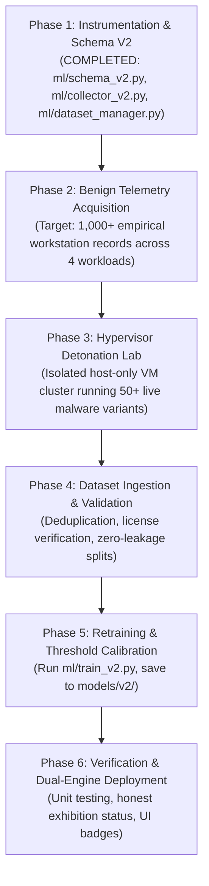

# SENTINELML V2 — MODEL V2 REBUILD AND MIGRATION PLAN

**Document Version:** 2.0.0  
**Target Release:** SentinelML V2 Next-Gen Rebuild  
**Status:** Approved Architectural Blueprint  

---

## 1. Executive Overview

This plan defines the end-to-end transition path from SentinelML's legacy experimental baseline (the 19-position synthetic Volatility model) to a **scientifically validated behavioral detector based on Schema V2**.

### Non-Negotiable Rollback Safeguards:
1. **Preserve Legacy Baseline:** The files [`models/saved_model.pkl`](file:///c:/Users/vasur/Desktop/SentinalMl/models/saved_model.pkl), [`models/scaler.pkl`](file:///c:/Users/vasur/Desktop/SentinalMl/models/scaler.pkl), and [`models/metrics.json`](file:///c:/Users/vasur/Desktop/SentinalMl/models/metrics.json) **remain completely untouched**.
2. **Dedicated V2 Directory:** All newly trained V2 artifacts, scalers, and manifests are written exclusively to `models/v2/`.
3. **Dual-Model Support:** The runtime architecture allows selecting between `DETECTOR_VERSION = "V1_LEGACY"` (exhibition baseline) and `DETECTOR_VERSION = "V2_EMPIRICAL"` via configuration.

---

## 2. Rebuild Phases and Milestones

### Phase Details:

### Phase 1: Instrumentation and Tooling (Completed)
- Designed 16-feature Schema V2 with formal mathematical bounds.
- Implemented `BenignTelemetryCollector` with 4 workload runners.
- Implemented `DatasetManager` with deduplication and data readiness gates.
- Implemented `ModelTrainerV2` with leakage-free scaling and validation-set threshold calibration.

### Phase 2: Empirical Benign Telemetry Collection
- **Duration:** 1 to 2 weeks.
- **Hardware Diversity:** Deploy collector on 5 distinct Windows 11 / Windows 10 configurations (Intel Core i7/i9, AMD Ryzen, virtualized environments).
- **Workloads:**
  - Standard enterprise office productivity (Word, Excel, browser research).
  - Software development (Git, compiler builds, node_modules restore).
  - Archive creation (7-Zip, WinRAR, TAR backups).
  - Continuous background streaming and updates.
- **Target Volume:** $\ge 2,500$ observations with mean quality score $> 0.95$.

### Phase 3: Hypervisor Detonation Lab Setup
- **Hypervisor Environment:** VMware ESXi or Proxmox VE.
- **Network Isolation:** Host-only private virtual switch (`192.168.200.0/24`) with an INetSim DNS/HTTP sinkhole emulator. Zero physical LAN or internet routing.
- **Telemetry Daemon:** Lightweight background script running `BenignTelemetryCollector.sample_once()` every 2 seconds.
- **Malware Corpus:** Sourced from authorized academic repositories (MalwareBazaar, VirusShare, the Zoo):
  - LockBit 3.0 (Builder variant)
  - WannaCry (Killswitch patched to local sinkhole)
  - BlackCat / ALPHV
  - Conti
  - Babuk
- **Target Volume:** $\ge 500$ empirical timeseries vectors capturing pre-encryption, active encryption, and post-encryption phases.

### Phase 4: Dataset Ingestion and Validation
- Import data via `DatasetManager.import_dataset()`.
- Filter out duplicate rows.
- Verify Schema V2 bounds on all 16 features.
- Confirm readiness status through `DatasetManager.check_readiness_for_training()`.

### Phase 5: Leakage-Free Training
- Execute `python -m ml.train_v2 --dataset data/empirical_corpus_v2.jsonl`.
- Calibrate $t^*$ on validation split (target precision $\ge 0.99$).
- Evaluate final model on held-out unseen malware families.
- Serialize artifacts to `models/v2/saved_model_v2.pkl`, `models/v2/scaler_v2.pkl`, `models/v2/metadata_v2.json`.

### Phase 6: Dual-Engine UI Integration
- Update UI to clearly display which engine is evaluating telemetry:
  - `[EXPERIMENTAL BASELINE (V1)]` — for legacy synthetic demonstration.
  - `[EMPIRICALLY VALIDATED (V2)]` — for the rebuilt behavioral model.
